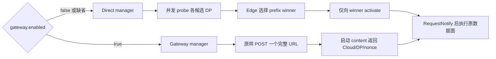

# LWD 显式网关配置与双模式协调面

## 目标

顶层 `gateway` 明确选择 Edge 与 Cloud 之间的 HTTP 协调协议：

- 未配置 `gateway` 或 `gateway.enabled: false`：保留 direct-DP 的 `coord_url`、`/v1/lwd/probe`、并发 prefix 命中比较、winner-only `/v1/lwd/activate` 流程。
- `gateway.enabled: true`：每个请求只向一个网关入口发起一次 Chat Completions 流式请求，由网关选择 Cloud/DP，Edge 根据启动 content 绑定后续 `RequestNotify`、数据面、abort 和结果归属。

`gateway.url` 是唯一的逻辑网关入口，不是 Cloud/DP 地址。Edge 不在多个网关地址间轮询；网关高可用由外部 VIP、DNS 或负载均衡提供。

## 配置

以下片段仅展示本模式相关字段，其余 deployment、rank、数据面字段不变：

```yaml
gateway:
  enabled: true
  url: https://gateway.example.com/cloud-a/v1/chat/completions
  connect_timeout: 10.0

edges:
  - id: 0
    coordination:
      enabled: true
      tenant_key_file: /etc/lwd/tenant.key
      placement_only: false
      probe_timeout: 25.0
    dp:
      - {dp_idx: 0, addr: 10.0.0.1, ranks: [0]}

clouds:
  - id: 0
    coordination:
      enabled: true
      listen_host: 0.0.0.0
      probe_timeout: 25.0
    dp:
      - dp_idx: 0
        addr: 10.1.0.1
        ranks: [1, 2, 3, 4, 5, 6, 7, 8]
        ctrl_port: 5550
        coord_port: 8100
```

约束：

- `url` 必须是唯一的完整 HTTP(S) endpoint，包含非根路径；客户端原样 POST，不追加 `/v1/chat/completions`，也没有单独的 `path` 字段。
- URL 不允许空白、用户信息或 fragment。启用 gateway 时必须配置 `url`。
- 启用 gateway 时，每个 Edge 和 Cloud 实例都必须启用 coordination；Cloud 仍通过 `coord_port` 提供本 DP 的监听。
- `coord_url` 只服务 direct 模式。gateway 模式不读取它，也不根据它选择 Cloud。
- 平台鉴权凭证继续使用 `VLLM_LWD_CLOUD_API_KEY`，不写入拓扑 YAML。

回退到 direct 模式：

```yaml
gateway:
  enabled: false
  url: https://gateway.example.com/cloud-a/v1/chat/completions
```

也可以完全删除 `gateway` 块。此时 Cloud 的每个 DP 按原规则配置 `coord_port/coord_url`。

## 运行流程



网关模式的 Cloud 上游固定提供 `POST /v1/chat/completions`。网关可以把不同的外部完整 path 路由到不同 Cloud，但转发到 Cloud 时必须保留控制头和摘要 JSON，并路由到该 Cloud 的边云接口。

同一条响应依次发送：

1. `choices[0].delta.content` 中的 JSON 启动消息，`role: assistant`、`finish_reason: null`；多 Cloud 必须含 `cloud_id`，多 DP 必须含 `engine_index`，并携带本次 `prefix_nonce`。
2. `choices[0].delta: {}`、`finish_reason: null` 的空 delta 帧。
3. 推理期间每 10 秒 `: edge-cloud-usage-pending` 心跳。
4. `choices: []` 的真实 usage，包含 cached tokens；usage 不可用或异常时发送 `: edge-cloud-usage-unavailable`，不伪造零用量。
5. `data: [DONE]`。

Edge 收到并完整校验启动消息后才准入和发送 `RequestNotify`。启动后后台持续读取 usage；abort 或同 ID 重提不取消已建立的 drain。应答 Cloud/DP、RequestNotify 目标、实际运行 DP 和发布 usage 的 DP 必须一致。

请求体严格只有 `model/messages/stream/stream_options`，内部请求固定 `stream=true`、`include_usage=true`。握手只依赖 SSE content，不依赖网关是否透传响应头。

网关模式的 usage 等待分为两个独立阶段：固定 30 秒的 `RequestNotify/usage_start` 接入等待，以及收到 `usage_start` 后重新开始计算的基础 600 秒执行期限。Edge 按 `600 + max_tokens` 秒为单请求预留执行预算（保守按最低 1 token/s），通过 `X-Lwd-Usage-Execution-Timeout-Ms` 发送，Cloud 按该值设置执行等待期限，不另设统一硬上限。`sampling_params` 缺失或 `max_tokens=None` 时与 `RequestNotify` 使用同一默认值（当前为 16），对应预算为 616 秒。直连模式保持原行为：只限制接入等待，收到 `usage_start` 后不设置执行总超时。

## 代码边界

- `vllm/config/lwd/topology.py`：`LwdGateway`、完整 URL 和跨实例模式校验；拓扑 digest 包含有效 gateway 配置。
- `control_edge_scheduler/lwd_gateway_client.py`：完整 URL 单流请求、分片 content 重同步和启动解析。
- `control_edge_scheduler/lwd_gateway_activation.py`：唯一网关入口、启动后 Cloud/DP 绑定和 drain 生命周期。
- `control_cloud_scheduler/lwd_gateway_control.py`：Cloud 五事件合同、心跳、usage 与不可用收流。
- `tools/gen_lwd_topology.py`：`--gateway-url` 生成顶层 `gateway` 块，并为原本未协调的场景补齐实例 `coordination`。
- 原 `lwd_edge_probe.py`、`lwd_edge_client.py` 的 direct probe/activate 和 `create_lwd_cloud_control_app()` 的 direct 路由继续服务未启用 gateway 的部署。
